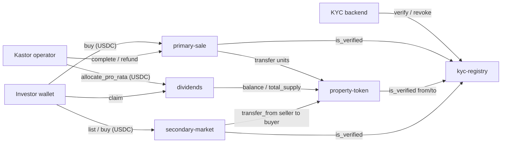

# Kastor Finance on Soroban

Soroban (Stellar) port of the smart contracts behind **Kastor Finance**, a real-estate tokenization platform: investors pass KYC, buy fractions of a property with a dollar stablecoin, and receive rental income in their wallet.

Kastor's production contracts are written in Solidity and were developed between 2022 and 2024, with the token, whitelist and first escrow deployed on BNB Smart Chain ([`kastor-smart-contracts`](https://github.com/kastorfinance/kastor-smart-contracts), private). This repository rewrites them in Rust for Soroban, keeps the business rules, and fixes three bugs found in the Solidity source while porting (see [docs/MIGRATION.md](docs/MIGRATION.md)).

> **Status:** testnet only. Not audited. Not yet used by real investors or real funds.

## Production contracts on BNB Smart Chain

The Solidity contracts this repository ports. Addresses from the deployment record of `kastor-smart-contracts` (chain 56):

| Contract | Address |
|---|---|
| `KastorToken` (ERC-1155) | [`0xA1394D580b5DB91128658E146a30154Ab01dF4CA`](https://bscscan.com/address/0xA1394D580b5DB91128658E146a30154Ab01dF4CA) |
| `WhitelistVault` | [`0x38C9253F08d7b8313F6b6e641Ff7B022a725c31C`](https://bscscan.com/address/0x38C9253F08d7b8313F6b6e641Ff7B022a725c31C) |
| `KastorEscrowV1` | [`0x44A39895859f9e12e81f802fD3Ea5cd5aa97DA4a`](https://bscscan.com/address/0x44A39895859f9e12e81f802fD3Ea5cd5aa97DA4a) |

## Contracts

| Contract | Replaces (BSC) | What it does |
|---|---|---|
| [`kyc-registry`](contracts/kyc-registry) | `WhitelistVault` | Operators (the KYC backend) mark wallets as verified until a given ledger. Verification can be revoked. |
| [`property-token`](contracts/property-token) | `KastorToken` (ERC-1155) | One SEP-41 token per property, `decimals = 0` (1 unit = 1 fraction). Supply is minted once. Sender and recipient must be verified. Pause, restricted mode with transfer agents, lockable IPFS metadata URI. |
| [`primary-sale`](contracts/primary-sale) | `KastorEscrowMultiple`, `KastorEscrowV2` | The investor pays USDC into escrow and units are reserved. After the holding period the operator settles (USDC to the treasury, units to the investor) or refunds. The buyer can self-refund if the operator never acts. |
| [`dividends`](contracts/dividends) | `KastorRoyalties` | The operator allocates rental income, either as explicit amounts or pro-rata to token balances, funding it in the same call. Each holder claims once per allocation. |
| [`secondary-market`](contracts/secondary-market) | none (new) | The secondary market from Kastor's whitepaper. A verified holder lists units at a price; another verified investor buys all or part of them in USDC. Non-custodial: units stay with the seller until sold, so listed units keep earning rental income. 1 % fee to the treasury, capped at 10 %. |



## Testnet deployment

Deployed and exercised end to end on **2026-10-15** with [`scripts/deploy-testnet.sh`](scripts/deploy-testnet.sh), from the attested [`v0.2.0` release](https://github.com/kastorfinance/kastor-soroban/releases) (SEP-55). The script checks each build attestation before deploying. Ids and wasm hashes are in [`deployments/testnet.json`](deployments/testnet.json).

| Contract | Contract id |
|---|---|
| kyc-registry | [`CA6SOHYO…2PJJTPKS`](https://stellar.expert/explorer/testnet/contract/CA6SOHYO5DETMAAZ77DLHFXZZLVJ6N5ITKD4TOEZRWK3MWC52PJJTPKS) |
| property-token (KV01) | [`CBEHZP76…LNZJDQD2`](https://stellar.expert/explorer/testnet/contract/CBEHZP76T5A4O7WZMPZIJ2C72CWLIVCLRFENBTGNLT4ZWG24LNZJDQD2) |
| primary-sale | [`CAGA2AJR…FDDR4IG6H`](https://stellar.expert/explorer/testnet/contract/CAGA2AJRGDREG626YH23UNPZ2SOH2EFIDEQ2PPX4X7JDPZ2FDDR4IG6H) |
| dividends | [`CA7KC5QP…OK2VY6RK`](https://stellar.expert/explorer/testnet/contract/CA7KC5QPQJVSBAMJT7TAHWAXIZXLYLCSQITIV23FRS75ZD72OK2VY6RK) |
| secondary-market | [`CCOHCOAL…XHKAJTFD`](https://stellar.expert/explorer/testnet/contract/CCOHCOALRJ7CQKSHFW2X5GHNTCN5F6OVVYLU4WQLTHGY5GDKXHKAJTFD) |

The demo uses `KUSD`, a test asset issued by the script, in place of USDC. Transactions from that run:

- Alice buys 10 KV01 (500 KUSD into escrow): [`154644ca…`](https://stellar.expert/explorer/testnet/tx/154644ca60e67f5edaf044a9e0d9bf3cc6b167b3c66a3a11a6f0842106715597)
- Purchase settled (500 KUSD to the treasury, 10 KV01 to Alice): [`7e4aedfd…`](https://stellar.expert/explorer/testnet/tx/7e4aedfdb6f348773d5362d2978ed658f9b932f7b5be200eac4b0131f19e3f61)
- Rental income claimed (10 KUSD, 1 % of a 1,000 KUSD allocation): [`bd0e07a0…`](https://stellar.expert/explorer/testnet/tx/bd0e07a00050764a630bebdb8b91f6ab9f71f2059ee8dceb360f5356e18ea8cd)
- Secondary market: Alice lists 4 KV01 at 55 KUSD [`2529e4ad…`](https://stellar.expert/explorer/testnet/tx/2529e4ad783c49ba9e587a5acbbd94c57f93366b330703fa8f0ad4a19266eb96), Carol buys 2 [`58d09802…`](https://stellar.expert/explorer/testnet/tx/58d09802e04037a47c2fc1ae0064abb6cce6d672d8e12d3bc9fb670e1f4700a8)
- Transfer of KV01 to a wallet without KYC: rejected with `Error(Contract, #7)` (`NotVerified`) during simulation.

Testnet is reset periodically. After a reset, run `RELEASE=v0.2.0 ./scripts/deploy-testnet.sh` again and the ids above change.

## Build and test

Requires Rust 1.98.1 (pinned in `rust-toolchain.toml`) and the [Stellar CLI](https://developers.stellar.org/docs/tools/cli) 28 or later.

```bash
cargo test                                      # 59 unit and cross-contract tests
cargo clippy --all-targets -- -D warnings
stellar contract build                          # wasm in target/wasm32v1-none/release
./scripts/deploy-testnet.sh                     # deploy + full demo on testnet (needs jq)
RELEASE=v0.2.0 ./scripts/deploy-testnet.sh      # same, from the attested release WASM
```

Every push runs format, clippy, tests with a coverage floor of 80 % of lines, and the wasm build ([`ci.yml`](.github/workflows/ci.yml)). Tagging `v*` publishes attested builds per [SEP-55](https://github.com/stellar/stellar-protocol/blob/master/ecosystem/sep-0055.md) ([`release.yml`](.github/workflows/release.yml)).

## Design notes

- **One token per property.** On BSC one ERC-1155 contract held every property under a token id. On Soroban each property is its own SEP-41 contract, so any Stellar wallet or explorer reads it as a normal token, and one property's settings (pause, restrictions) cannot affect another.
- **Compliance lives in the token.** The KYC check runs inside `transfer`, so it applies to any wallet or dApp, not only Kastor's frontend.
- **Time in ledgers.** Holding periods and KYC expiry use ledger sequence numbers (about 5 s each), not timestamps.
- **Storage TTL.** Balances, verifications and purchases are persistent entries whose TTL is extended on use. Allowances are temporary entries that expire with the approval.

## License

[Apache-2.0](LICENSE). See [AI_DISCLOSURE.md](AI_DISCLOSURE.md) for how AI tools were used in this repository.
